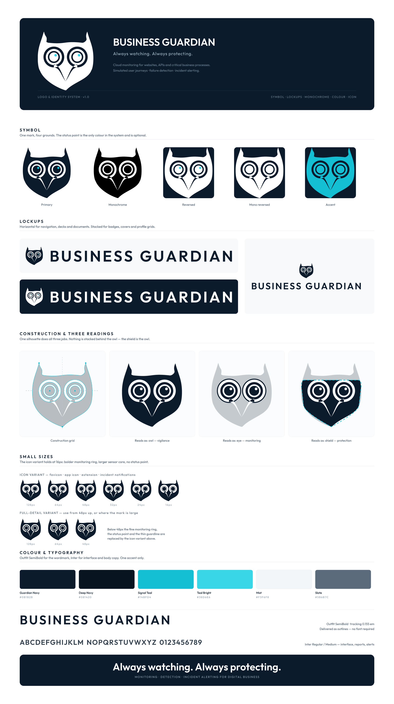

# BUSINESS GUARDIAN — Logo & Identity System

**Always watching. Always protecting.**

A single vector identity for a cloud monitoring platform: an owl that is also a
shield, with a monitoring eye, built on one 512 × 512 construction grid.



---

## 1. The idea in one line

The silhouette is an owl head **and** a shield — not an owl with a shield behind
it. The eye is an owl eye **and** a monitoring sensor — not a radar drawn inside
an eye. Both readings come from the same geometry, so the mark stays one object
at every size.

| Layer | What you see first | What it means |
| --- | --- | --- |
| Ear tuft + crown | Owl | Intelligence, vigilance |
| Socket → ring → pupil → status point | Eye, sensor | Continuous monitoring, detection |
| Wall → wall → single point | Shield | Protection, reliability |
| Guardline (the facial-disc edge) | Beak / brow lines | Watch → detect → protect |

The three readings are documented in `svg/61-63-concept-*.svg` and shown on the
brand sheet.

---

## 2. What is in this folder

```
business-guardian-logo/
├── svg/                     ← the masters (self-contained, no font required)
│   ├── 01-emblem-primary.svg        A. primary emblem, colour
│   ├── 02-emblem-navy.svg           B. symbol only, Guardian Navy
│   ├── 03-emblem-black.svg          E. monochrome black
│   ├── 04-emblem-white.svg          E. monochrome white (use on dark)
│   ├── 05-emblem-reverse.svg        F. reversal with bright accent dot
│   ├── 10-13-lockup-horizontal-*.svg  C. symbol + BUSINESS GUARDIAN (4 grounds)
│   ├── 20-23-lockup-stacked-*.svg     D. symbol above wordmark (4 grounds)
│   ├── 30-32-icon-*.svg             G. small-size icon variant
│   ├── 40-app-tile.svg              512px app tile (iOS/Android/PWA)
│   ├── 41-app-tile-light.svg        light-ground tile
│   ├── 50-51-wordmark-*.svg         wordmark outlines, black / white
│   ├── 60-construction.svg          the construction grid
│   ├── 61..63-concept-*.svg         owl / eye / shield readings
│   ├── 70-clearspace.svg            clear space + minimum sizes
│   ├── 80-brand-sheet.svg           everything on one page (SVG)
│   ├── 90-applications.svg          the identity in use
│   └── 91-app-icons.svg             app-tile ladder
├── png/                     ← raster exports (favicons, icons, lockups, sheets)
├── favicon.ico              ← 16/24/32/48/64 multi-size Windows/browser icon
├── docs/                    ← rendered sheets, scale tests, guidelines
│   ├── brand-sheet.png              whole system on one page
│   ├── applications.png             real interface placements
│   ├── scale-test.png               16 → 192 px ladder
│   ├── app-icons.png                app tile at real icon sizes
│   ├── construction.png             60-construction.svg
│   ├── 6x-concept-*.png             the three readings
│   ├── 70-clearspace.png            clear space + minimum sizes
│   └── GUIDELINES.md                full usage rules
└── tools/                   ← generators (only needed to regenerate)
```

Every SVG is standalone: paths only, no linked fonts, no external references,
no embedded rasters. Open one in a browser, drop it in Figma, or inline it in
HTML with no further work.

---

## 3. Colour

| Name | Hex | Use |
| --- | --- | --- |
| Guardian Navy | `#0B1B2B` | Primary mark and wordmark |
| Deep Navy | `#081420` | Deepest surfaces, footer, hero |
| Signal Teal | `#14BFD4` | The single accent — status point |
| Teal Bright | `#38D6E6` | Accent on dark grounds |
| Mist | `#F3F6F8` | Light neutral surface |
| Slate | `#5B6B7C` | Secondary type, interface detail |
| Black / White | `#000000` / `#FFFFFF` | Monochrome reproduction |

**Rules**

* One accent only. Never gradient the accent dot or the mark.
* The mark must survive with no colour at all — test in pure black first.
* On dark grounds use `#38D6E6`; on light grounds use `#14BFD4`.
* Signal Teal is never used as a large fill behind the mark.

---

## 4. Typography

* **Wordmark** — Outfit SemiBold, uppercase, tracking `0.155 em`, word gap
  `0.5 × cap height`, aligned so the symbol's cap centre meets the wordmark's
  optical centre. Delivered as **outlines** in every file, so it renders
  identically without the font installed.
* **Interface / body** — Inter Regular & Medium.

Never re-set the wordmark by typing it: use the provided outlines, or apply the
tracking values above if you must rebuild it.

---

## 5. Clear space, minimum sizes, misuse

* **Clear space** — half the wordmark cap height on all four sides of any
  lockup; nothing enters that zone.
* **Minimum sizes** — icon variant from 16 px; the full-detail emblem from
  48 px; horizontal lockup from 90 px wide; stacked lockup from 64 px wide.
* **Below 48 px** the icon variant replaces the fine monitoring ring, the
  status point and the thin guardline with a bolder eye.
* **Never** stretch, rotate, re-colour, outline, add shadow/bevel/glow, place on
  a busy photo without a solid panel, re-draw the owl, or set the wordmark in
  another typeface.

---

## 6. Using the files

**Web**

```html
<link rel="icon" href="/favicon.ico" sizes="any">
<link rel="icon" type="image/svg+xml" href="/icon-32.svg">
<link rel="apple-touch-icon" href="/apple-touch-icon-180.png">
```

Use `30-icon-primary.svg` for the SVG favicon (scales to any DPI), and
`40-app-tile.svg` for PWA/Android maskable icons.

**Docs, decks, print** — `10-lockup-horizontal-primary.svg` on light grounds,
`13-lockup-horizontal-reverse.svg` on dark. Both are pure vector, so they scale
to any print size.

**Monochrome / single-colour printing** — `03-emblem-black.svg` or
`04-emblem-white.svg`. The mark works as a pure silhouette.

---

## 7. Regenerating the assets

Requires Node 18+.

```bash
cd business-guardian-logo
npm install          # opentype.js, @resvg/resvg-js, @expo-google-fonts/outfit
npm run build        # writes svg/, png/ and favicon.ico
```

`tools/emblem.mjs` holds the whole symbol as parameters — crown shape, tuft
angle, eye radii, guardline depth, shield taper. Change a number, run the build,
and every deliverable updates. `tools/wordmark.mjs` sets the type and converts
it to outlines. `tools/diagrams.mjs`, `sheet.mjs` and `applications.mjs` render
the explanatory pages.

---

## 8. Design constraints honoured

* **One coherent symbol** — the shield is the owl's own outline; the sensor is
  the owl's own eye. Nothing is stacked or pasted on.
* **Not a mascot** — no face features, no cartoon expression, no eyes with
  highlights or eyelashes. The mark reads as an insignia.
* **Not militaristic** — no chevrons, stars, ribbons or metal styling.
* **Not a surveillance camera, human eye, robotic eye or evil glow** — the eye
  is a symmetric ring-and-core, sized and spaced as an owl's.
* **Monochrome first** — every variant is proven in pure black, and the whole
  system works with the accent removed.
* **Legible at 16 px** — verified in `png/icon-navy-16.png`.
